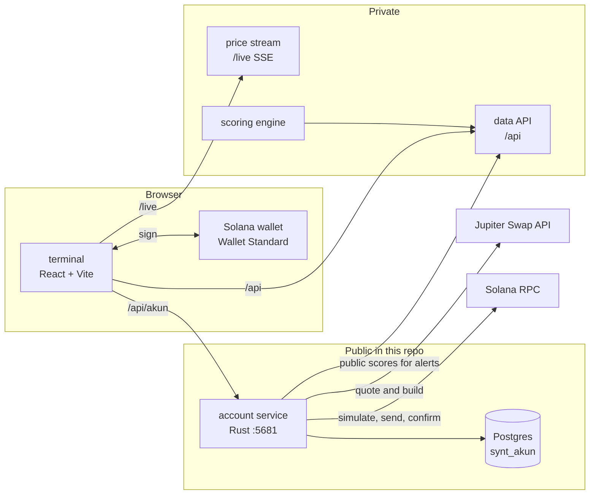

# synt

**synt is a trading terminal for new Solana pairs that puts an audit score on every pair.** Each score comes with its track record: how often pairs at that score collapsed in the past. You can also trade from the same screen, and your own wallet signs every transaction.

**Live demo:** https://preview.synt.fun (Solana mainnet)

The usual workflow for a new pump.fun pair is to open five tabs (a bonding-curve viewer, a holder scanner, a creator lookup, a chart and a swap site) and still guess. synt does that work once per pair, while the pair is minutes old, and shows the result next to the chart. A trader goes from a new pair to a decision in a few seconds:

1. **Trenches** lists new, bonding and graduated pairs as they appear. Each row shows a score from 0 to 100 and the main risk behind it.
2. **The token page** explains the score: creator history, holder concentration, bundled early buys, curve progress, and how the score moved during the pair's first ten minutes.
3. **Buy or sell** from the same page, or straight from the Trenches row. The review dialog shows the quote, the minimum received, the price impact and the fees. The wallet signs, and synt charges no fee.

A score is not advice. It tells you how often pairs at that score collapsed in the past, and even at the top score about 1 in 10 did. Every score is published as it was given at the time and is never changed afterwards, including when it turns out to be wrong.

## What is in this repository

| Folder | What it is | Stack |
|---|---|---|
| [`terminal/`](terminal/) | The web terminal: Trenches, token pages, charts, Discovery, the leaderboard, the wallet tracker, accounts and trading UI | React 18, TypeScript, Vite |
| [`account/`](account/) | The account and trading service: wallet sign-in, profiles, watchlist sync, alerts, and non-custodial trade building and tracking | Rust, axum, sqlx, Postgres |
| [`recorder/`](recorder/) | A recorder for the BNB Chain launchpads four.meme and Flap: launches, bonding curve trades, graduations and pool prices, written to Postgres. It runs on its own and needs nothing else from this repository | Rust, tokio, sqlx, Postgres |

The scoring engine, the market data API and the price stream are **not** in this repository. They stay private. The terminal only talks to them over a public HTTP API, so you can run the terminal locally against the live demo (see [Quick start](#quick-start)).

## Architecture



In production a reverse proxy (Caddy) serves the built terminal and routes `/api/akun/*` to the account service, `/api/*` to the data API and `/live/*` to the price stream. The account service has its own database and role, and it cannot read the engine's data.

## How Solana is used

- **Sign in with Solana.** The wallet signs a [SIWS](https://github.com/phantom/sign-in-with-solana) message bound to the site's origin and a one-time nonce. The server checks the ed25519 signature (`account/src/siws.rs`) and issues an HttpOnly `__Host-` session cookie. Wallets are discovered through the Wallet Standard (Phantom, Solflare, Backpack, MetaMask for Solana).
- **Non-custodial swaps.** `account/src/dagang.rs` and `account/src/soltx.rs`:
  1. Request a route from Jupiter's `/swap/v2/build`.
  2. Assemble a v0 transaction by hand (no `solana-sdk`) with address lookup tables.
  3. Simulate it with `sigVerify: false` to measure the compute units it really uses.
  4. Rebuild it with a compute limit of that usage plus 20% plus 10k, and a priority fee taken from the user's own lamport budget.
  5. The wallet signs.
  6. The server checks that the fee payer is the signed-in wallet (`verify_strict`), then sends the transaction and rebroadcasts it every 2 s until it confirms or its blockhash expires.

  The service never holds or asks for a private key.
- **Clean exits.** Selling the full balance of a token also closes the empty token account in the same transaction, so the roughly 0.002 SOL of rent goes back to the wallet. If simulation rejects the close, the transaction is rebuilt without it.
- **Positions from chain truth.** Each confirmed trade records the actual SOL and token balance changes, read from the confirmed transaction rather than from the quote. Positions and P/L are built from those changes.
- **Scores from Solana data.** The engine (private) watches every pump.fun launch from its first second, using on-chain and stream data, and scores it within minutes. The terminal renders those scores with their calibration.

The same account service also trades on BNB Chain (four.meme, Flap.sh, KyberSwap) for EVM accounts. That code path is in `account/src/bnb.rs`. Solana is the primary chain.

## Quick start

### Terminal only, against the live demo API

Requirements: Node 20 or newer.

```bash
cd terminal
npm install
VITE_API_ORIGIN=https://preview.synt.fun \
VITE_LIVE_ORIGIN=https://preview.synt.fun/live \
npm run dev
# open http://localhost:5173
```

Trenches, token pages, charts, Discovery and the leaderboard all work with live data this way. Signing in needs the account service (below), because the live demo only accepts sign-ins from its own origin.

### Full stack locally (terminal and account service)

See [`account/README.md`](account/README.md) for Postgres setup and environment variables. Short version:

```bash
# 1. Postgres: a role and a database used only by this service
sudo -u postgres psql -c "CREATE ROLE akun_rw LOGIN PASSWORD 'change-me'"
sudo -u postgres psql -c "CREATE DATABASE synt_akun OWNER akun_rw"

# 2. account service (migrations run at boot)
cd account
cp .env.example .env    # then edit DATABASE_URL, AKUN_ORIGINS, AKUN_RPC_URL
cargo run --release

# 3. terminal, with /api/akun pointed at the local service
cd ../terminal
VITE_API_ORIGIN=https://preview.synt.fun \
VITE_LIVE_ORIGIN=https://preview.synt.fun/live \
VITE_AKUN_ORIGIN=http://127.0.0.1:5681 \
npm run dev
```

The session cookie uses the `__Host-` prefix and requires HTTPS. For local sign-in, put the dev server behind a local TLS proxy and add that origin to `AKUN_ORIGINS`, for example:

```bash
caddy reverse-proxy --from localhost:8443 --to localhost:5173
# AKUN_ORIGINS=https://localhost:8443
```

## Safety and privacy choices

- The account service only verifies signatures. It never signs, never holds keys and never moves funds. Every trade is shown in a review dialog and then in the wallet before it is sent.
- synt charges no fee on trades. Jupiter's `/build` endpoint is used rather than `/order`, so no Jupiter fee applies either.
- An account is identified only by its public wallet address. The service stores no email, IP address or user agent. Deleting the account from the profile page removes the profile, watchlist, follows, alerts, settings and sessions right away.
- Every request that changes data must carry an allowed `Origin`, and sign-in messages are bound to the origin that requested them.
- The service runs as an unprivileged systemd `DynamicUser` with a strict sandbox (`account/ops/synt-akun.service`).

## Status

synt is in early access. Solana scoring and trading are live on mainnet at https://preview.synt.fun. Limit orders and MEV protection are not built yet.

Code comments are partly in Indonesian, the team's working language. User-facing text and API error messages are in English.

## License

`recorder/` is released under the MIT License, see [`recorder/LICENSE`](recorder/LICENSE). No license has been chosen yet for `terminal/` and `account/`.
